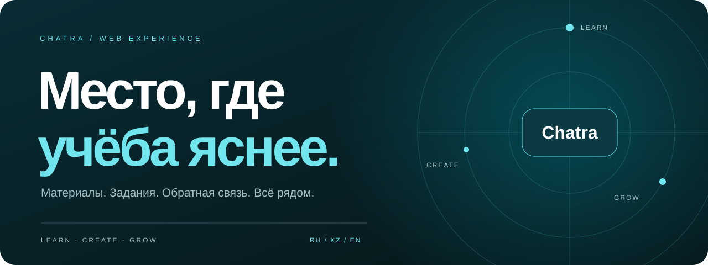
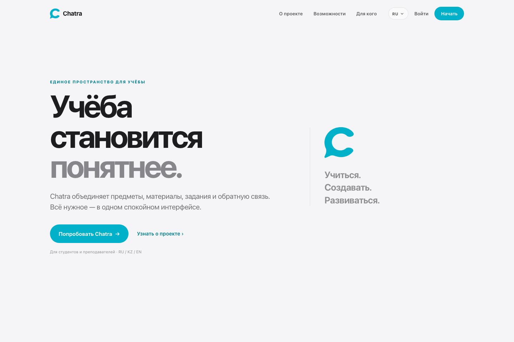
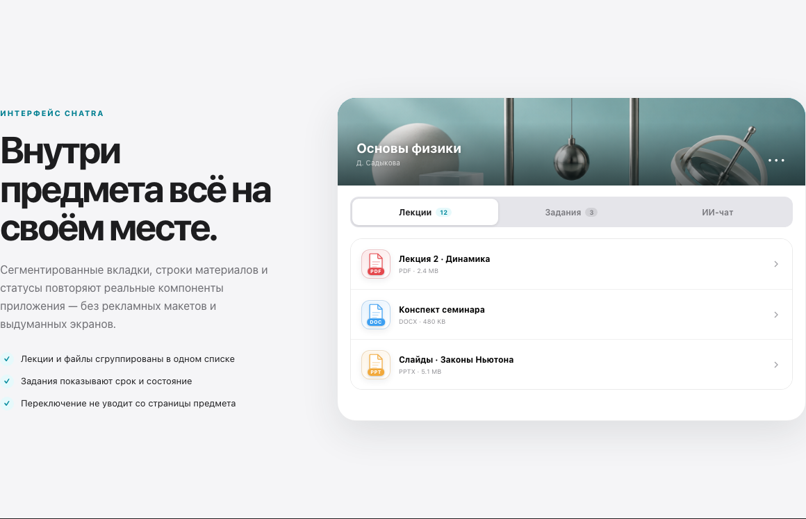
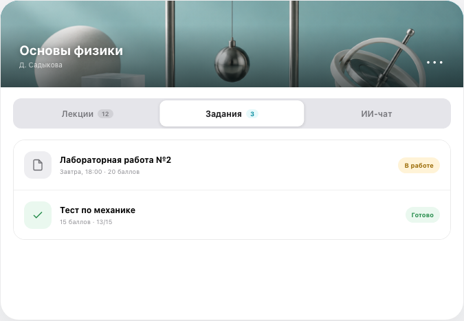
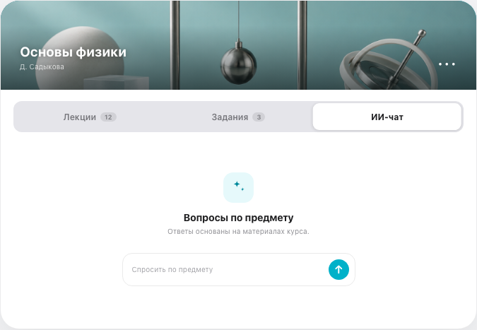
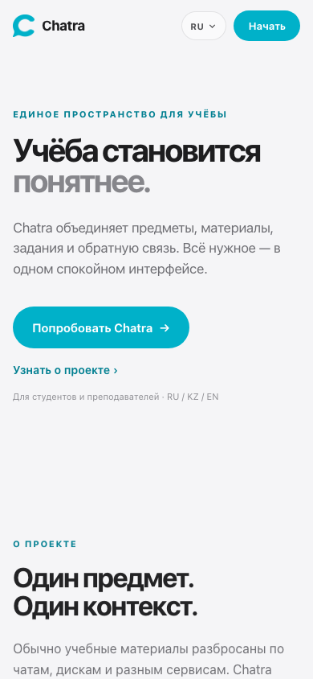

<div align="center">


# Chatra

**Учиться. Создавать. Развиваться.**

Образовательная платформа для студентов и преподавателей.<br>
Предметы, материалы, задания и ИИ-помощник — в одном пространстве.

<p>
  
  
  
  
</p>

[Интерфейс](#интерфейс) · [Возможности](#возможности) · [Быстрый старт](#быстрый-старт) · [Команды](#команды)

</div>



## Интерфейс

**01 / Первое знакомство**<br>
Спокойная типографика, бирюзовые акценты и фокус на учебном процессе.



**02 / Внутри предмета**<br>
Материалы курса собраны вместе: лекции, документы и презентации.



<table>
  <tr>
    <td width="50%"><strong>03 / Задания</strong><br>Сроки и статусы — рядом с работой.</td>
    <td width="50%"><strong>04 / ИИ-помощник</strong><br>Отдельная вкладка для вопросов по предмету.</td>
  </tr>
  <tr>
    <td></td>
    <td></td>
  </tr>
</table>

<details>
<summary><strong>05 / На небольшом экране — мобильная версия</strong></summary>

<p align="center">
  
</p>

</details>

<sub>Скриншоты сделаны из локально запущенной веб-версии. Карточки курса, заданий и ИИ-чата — интерактивные демонстрационные блоки страницы /landing.</sub>

## Возможности

| Учебный процесс | В Chatra |
| :--- | :--- |
| **Предметы и материалы** | Курсы, лекции и документы в контексте предмета |
| **Задания и обратная связь** | Сдача работ, сроки и результаты |
| **ИИ-помощник** | Работа с вопросами по учебным материалам |
| **Два сценария** | Интерфейсы для студентов и преподавателей |
| **Три языка** | Русский, қазақша, English |
| **Разные экраны** | Адаптивная веб-версия для компьютера и телефона |

---

## Быстрый старт

### 1. Настройте окружение

Создайте файл `.env` в корне фронтенда:

```env
NUXT_PUBLIC_API_BASE=http://localhost:8000/api
```

### 2. Установите зависимости

```bash
npm install
```

### 3. Запустите приложение

```bash
npm run dev
```

Откройте [localhost:3000](http://localhost:3000). Бэкенд должен быть запущен отдельно.

---

## Команды

| Команда | Назначение |
| :--- | :--- |
| `npm run dev` | Сервер разработки |
| `npm run build` | Сборка для продакшена |
| `npm run preview` | Предпросмотр сборки |
| `npm run typecheck` | Проверка типов |
| `npm run lint` | Проверка стиля кода |
| `npm test` | Модульные и компонентные тесты |
| `npm run test:e2e` | Сквозные тесты Playwright |

---

## Конфигурация

| Переменная | Назначение | Значение для разработки |
| :--- | :--- | :--- |
| `NUXT_PUBLIC_API_BASE` | Базовый URL API | `http://localhost:8000/api` |

Для продакшена укажите HTTPS-адрес вашего API с суффиксом `/api`.

Основные настройки приложения находятся в [`nuxt.config.ts`](nuxt.config.ts),
команды и зависимости — в [`package.json`](package.json).

---

<div align="center">

**Chatra** · Learn. Create. Grow.

<sub>© 2026 Chatra. All rights reserved.</sub>

</div>
