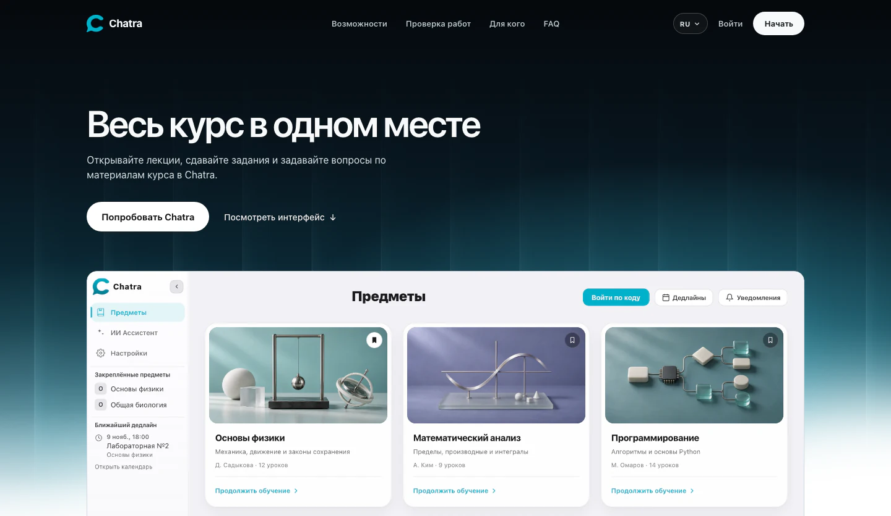
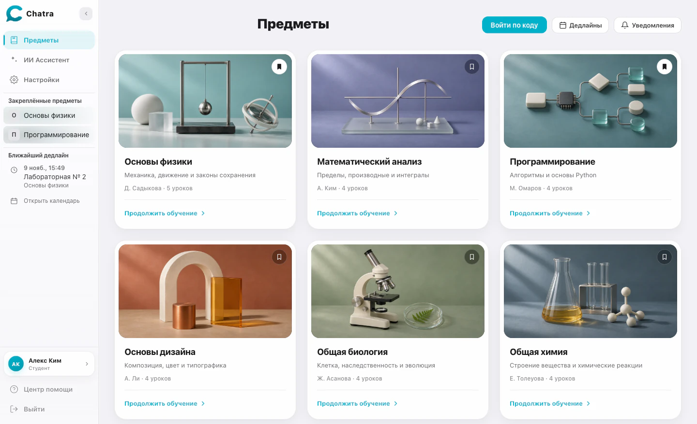
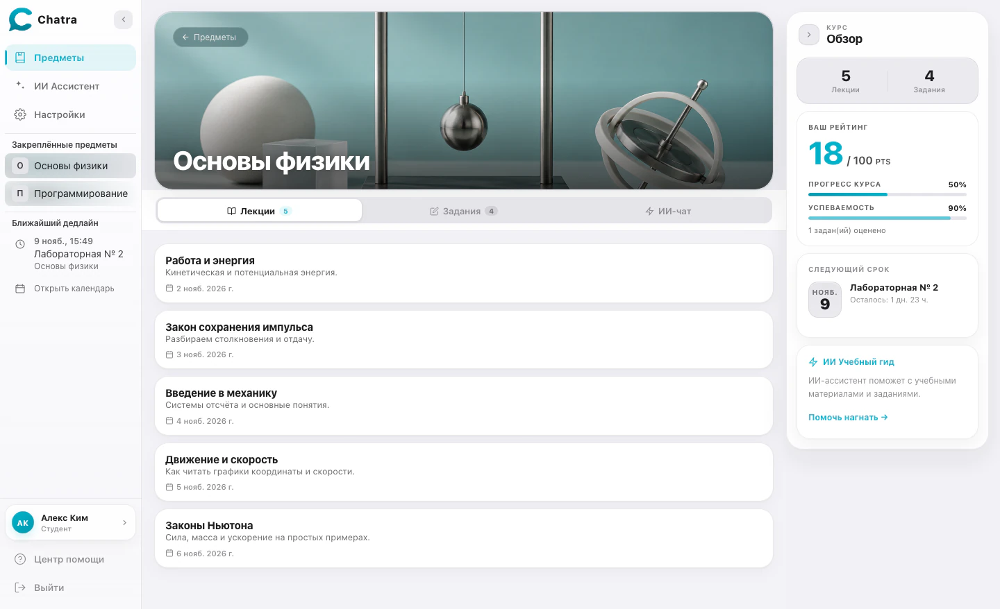
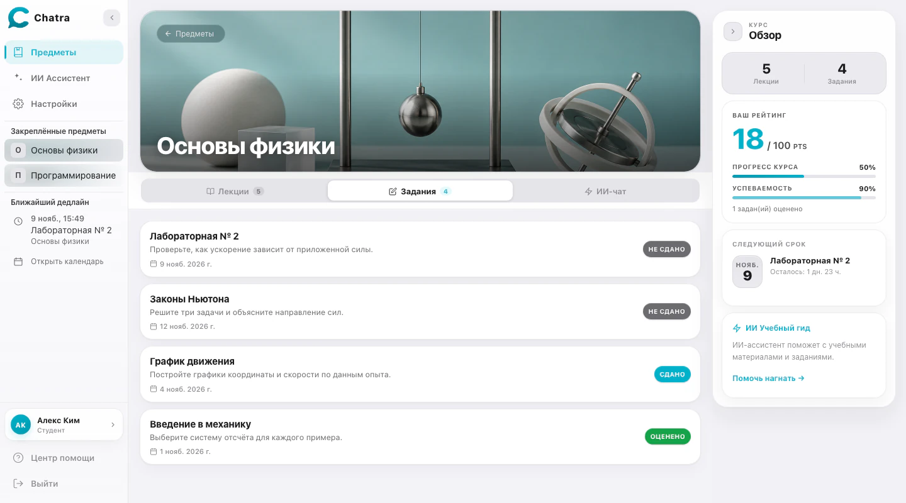
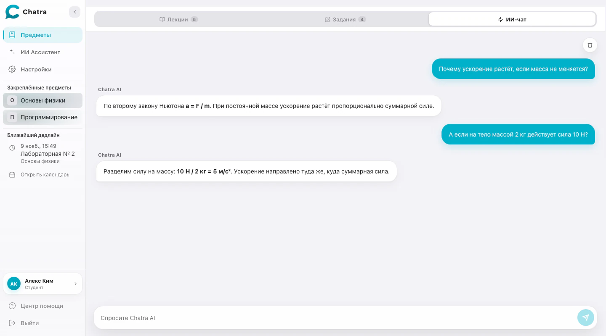
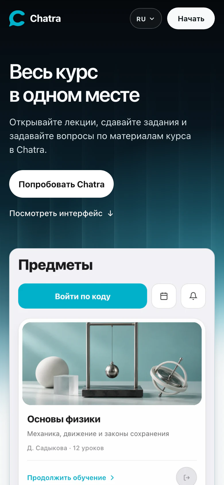
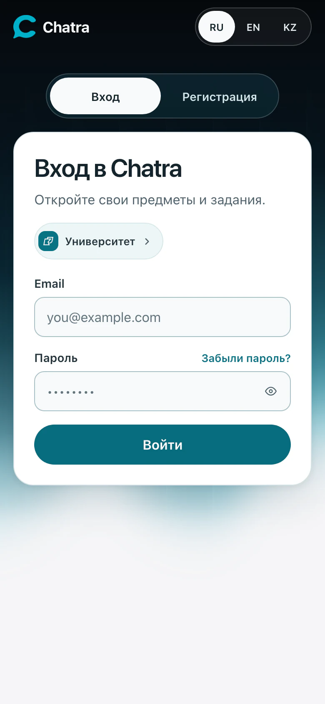
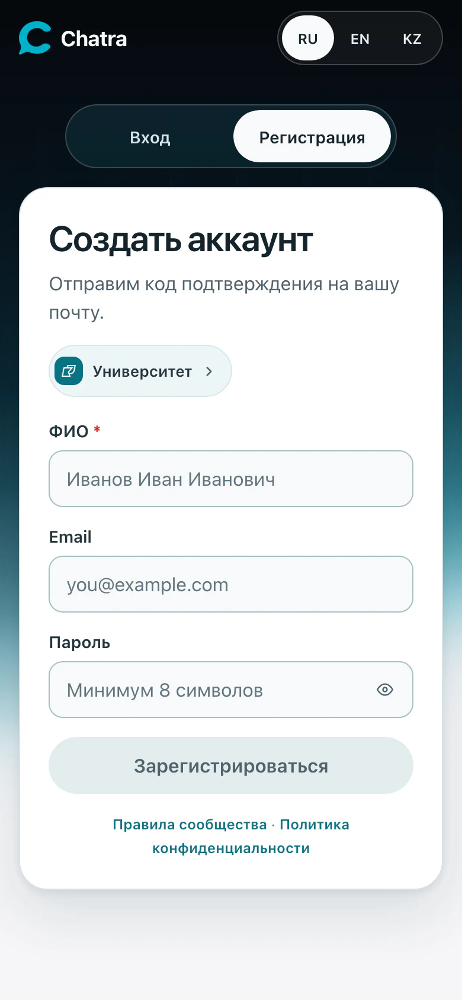

<div align="center">


# Chatra

**Учебная платформа для студентов и преподавателей**

Лекции, задания, дедлайны и ИИ-помощник в одном учебном пространстве.

<p>
  
  
  
  
</p>

[Возможности](#возможности) · [Интерфейс](#интерфейс) · [Быстрый старт](#быстрый-старт) · [Разработка](#разработка)

</div>

[](docs/images/landing-desktop.webp)

## Возможности

| Студентам | Преподавателям |
| :--- | :--- |
| Подключайтесь к предметам по коду и открывайте лекции и файлы внутри курса. | Создавайте предметы, публикуйте материалы и приглашайте студентов. |
| Следите за сроками в календаре, сдавайте работы и смотрите оценки с обратной связью. | Задавайте критерии проверки, просматривайте сдачи и запускайте ИИ-оценивание. |
| Задавайте вопросы ИИ-помощнику по темам и материалам предмета. | Ведите несколько учебных потоков и открывайте материалы прошлых лет в архиве. |

Веб-версия адаптируется под телефон. Интерфейс доступен на русском, казахском и английском.

## Интерфейс

### Каталог предметов

Карточки курсов, вход по коду и быстрый доступ к ближайшему дедлайну.

[](docs/images/catalog-desktop.webp)

### Внутри предмета

Лекции, задания и ИИ-чат открываются из одного курса. В обзоре рядом видны успеваемость и ближайший срок сдачи.

[](docs/images/course-preview.webp)

<table>
  <thead>
    <tr>
      <th width="50%">Задания</th>
      <th width="50%">ИИ-помощник</th>
    </tr>
  </thead>
  <tbody>
    <tr>
      <td><a href="docs/images/assignments-preview.webp"></a></td>
      <td><a href="docs/images/assistant-preview.webp"></a></td>
    </tr>
  </tbody>
</table>

<details>
<summary><strong>Мобильные экраны</strong> · лендинг, вход и регистрация</summary>

<table>
  <thead>
    <tr>
      <th width="33%">Лендинг</th>
      <th width="33%">Вход</th>
      <th width="33%">Регистрация</th>
    </tr>
  </thead>
  <tbody>
    <tr>
      <td><a href="docs/images/landing-mobile.webp"></a></td>
      <td><a href="docs/images/login-mobile.webp"></a></td>
      <td><a href="docs/images/register-mobile.webp"></a></td>
    </tr>
  </tbody>
</table>

</details>

<sub>Скриншоты сняты в локальной веб-версии. Предметы, работы и переписка на них демонстрационные.</sub>

## Быстрый старт

Понадобится Node.js 22, который используется в CI, и отдельно запущенный API Chatra.

1. Установите зависимости в папке фронтенда.

   ```bash
   npm ci
   ```

2. Создайте `.env` и укажите адрес API, доступный из браузера.

   ```env
   NUXT_PUBLIC_API_BASE=http://localhost:8000/api
   ```

3. Запустите сервер разработки.

   ```bash
   npm run dev
   ```

Откройте [localhost:3000](http://localhost:3000).

При размещении фронтенда и API за одним прокси можно использовать относительный путь `/api`. Для раздельного размещения укажите полный HTTPS-адрес API. Примеры есть в [`.env.example`](.env.example).

## Разработка

| Команда | Назначение |
| :--- | :--- |
| `npm run dev` | Запустить сервер разработки |
| `npm run build` | Собрать приложение для продакшена |
| `npm run preview` | Запустить собранную версию локально |
| `npm run typecheck` | Проверить типы |
| `npm run lint` | Запустить ESLint |
| `npm test` | Запустить модульные и компонентные тесты |
| `npm run test:e2e` | Запустить браузерные тесты на компьютере и телефоне |

Перед первым запуском браузерных тестов установите Chromium командой `npx playwright install chromium`.

Страницы находятся в [`pages/`](pages), компоненты в [`components/`](components), состояние приложения в [`stores/`](stores), клиент API в [`services/`](services). Основные настройки Nuxt находятся в [`nuxt.config.ts`](nuxt.config.ts).

---

<div align="center">
  <sub>© 2026 Chatra. All rights reserved.</sub>
</div>
